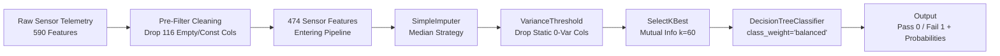

# Production Quality Prediction Using Machine Learning
### Semiconductor Manufacturing Quality Prediction & Demonstration Dashboard

A Streamlit analytics and demonstration application for production quality prediction in semiconductor fabrication, built on the **UCI SECOM** dataset.

---

## 📌 Project Overview

In semiconductor fabrication, hundreds of continuous sensor measurements monitor complex deposition, etching, chemical-mechanical polishing (CMP), and photolithography processes across fabrication tools. Identifying defective wafers early in the production cycle prevents:
- Wasteful downstream packaging and assembly costs.
- Costly wafer scrap excursions.
- Catastrophic customer quality escapes in critical applications.

This application provides an **academic ML demonstration dashboard** powered by the trained **Scikit-Learn pipeline** (`production_quality_model.joblib`) with embedded median imputation, variance thresholding, mutual-information feature selection, and a balanced Decision Tree classifier.

---

## 🔬 Dataset Information: UCI SECOM

- **Source:** UCI Machine Learning Repository — SECOM Dataset (McCann et al., 2008)
- **Total Records:** 1,567 production wafer runs
- **Total Raw Sensor Features:** 590 continuous inline process sensor signals (`Feature_1` to `Feature_590`)
- **Pre-Filtering:** 116 completely missing and zero-variance features removed before modeling → 474 usable features
- **Feature Selection:** Top 60 features selected via Mutual Information inside the pipeline
- **Target Distribution (Binary Classification):**
  - **Pass / Good Quality (0):** 1,463 samples (**93.36%**)
  - **Fail / Defect Issue (1):** 104 samples (**6.64%**)
- **Data Partitioning (Stratified 80/20 Split):**
  - **Training Set (80%):** 1,253 samples (1,170 Pass, 83 Fail)
  - **Held-Out Test Set (20%):** 314 samples (293 Pass, 21 Fail)
- **Key Challenges:** Severe class imbalance (14:1 ratio), high dimensionality, sensor dropouts, and noisy sensor telemetry.

---

## ⚙️ End-to-End Machine Learning Workflow



### Preprocessing Pipeline (Contained in Saved Joblib Artifact)
1. **Median Imputation (`SimpleImputer(strategy='median')`):** Replaces sensor dropouts using training-fold medians to avoid data leakage.
2. **Variance Filtering (`VarianceThreshold(threshold=0.0)`):** Eliminates static non-informative signals.
3. **Feature Selection (`SelectKBest(k=60, score_func=mutual_info_classif)`):** Reduces feature space to the top 60 non-linear informative features.
4. **Final Estimator:** `DecisionTreeClassifier(max_depth=8, min_samples_leaf=5, class_weight='balanced', random_state=42)`.

---

## 📊 Models Compared & 5-Fold Stratified Cross-Validation

Five machine learning models were evaluated using **5-Fold Stratified Cross-Validation** on the training partition (1,253 samples), prioritizing F1-Score, PR-AUC, and Recall:

| Model Architecture | Accuracy (Mean ± SD) | Precision (Mean ± SD) | Recall (Mean ± SD) | F1-Score (Mean ± SD) | ROC-AUC (Mean ± SD) | PR-AUC (Mean ± SD) | Selection Decision |
| :--- | :---: | :---: | :---: | :---: | :---: | :---: | :--- |
| **Decision Tree** | 0.7399 ± 0.045 | 0.1030 ± 0.029 | 0.4051 ± 0.200 | **0.1625 ± 0.053** | 0.6036 ± 0.073 | 0.1144 ± 0.025 | **Selected (Highest CV F1)** |
| **Logistic Regression** | 0.6855 ± 0.044 | 0.0972 ± 0.033 | 0.4449 ± 0.134 | 0.1591 ± 0.052 | 0.6141 ± 0.058 | 0.1599 ± 0.054 | Rejected (Lower F1) |
| **SVM (RBF Kernel)** | 0.9026 ± 0.016 | 0.1922 ± 0.160 | 0.1309 ± 0.093 | 0.1536 ± 0.117 | 0.6112 ± 0.070 | 0.1372 ± 0.050 | Rejected (Low Recall) |
| **XGBoost** | 0.9234 ± 0.005 | 0.2000 ± 0.163 | 0.0603 ± 0.054 | 0.0911 ± 0.080 | 0.6924 ± 0.055 | 0.1682 ± 0.023 | Rejected (Low Defect Recall) |
| **Random Forest** | 0.9330 ± 0.003 | 0.0000 ± 0.000 | 0.0000 ± 0.000 | 0.0000 ± 0.000 | 0.7173 ± 0.060 | 0.1984 ± 0.046 | Rejected (0% Defect Recall) |

> **The Accuracy Paradox in Imbalanced Classification:** Notice that Random Forest achieved 93.30% accuracy only because it predicted 100% of samples as Pass (Recall = 0.0, F1 = 0.0). Decision Tree with balanced class weights was selected because it achieved the highest F1 score (0.1625) and meaningful defect recall (40.51%).

---

## 🎯 Final Held-Out Test Set Performance (314 Samples)

- **Test Accuracy:** 76.43% (0.7643)
- **Test Precision:** 9.23% (0.0923)
- **Test Recall:** 28.57% (0.2857 — 6 / 21 Defects Captured)
- **Test F1-Score:** 13.95% (0.1395)
- **Test ROC-AUC:** 55.13% (0.5513)
- **Test PR-AUC:** 10.03% (0.1003)

### Confusion Matrix on Held-Out Test Set:
- **True Negatives (TN):** 234 Wafers (Correctly Approved Pass)
- **False Positives (FP):** 59 Wafers (False Alarms)
- **False Negatives (FN):** 15 Wafers (Escaped Defects)
- **True Positives (TP):** 6 Wafers (Defects Captured)

---

## 🚀 Installation & Running the Application

### 1. Install Dependencies
```bash
pip install -r requirements.txt
```

### 2. Verify Model File
Ensure `production_quality_model.joblib` resides in the project root.

### 3. Launch the Streamlit Dashboard
```bash
streamlit run app.py
```

Open `http://localhost:8501` in your browser.
